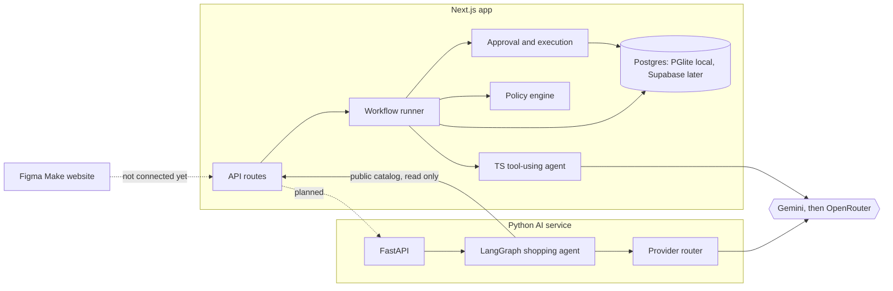

# Commercial Operations AI

An AI-assisted commerce platform with two connected experiences on one catalog and one rule set:

- **Customer:** an AI shopping assistant that finds, compares and combines consumer-electronics products.
- **Merchant:** an operations copilot that proposes bundles, checks them against business rules, and executes only after a human approves.

> **Principle: the AI proposes and explains; deterministic code validates and executes.**
> Prices, stock, margins, discount limits, approvals and execution results never come from a language model.

Built as a university project (AI course and software analysis and design course). All demo data is synthetic and labeled `isSynthetic`.

## Status

A feature is marked done only when it is implemented **and** tested. Test counts are from the last run on this branch:
web app 123 tests (Vitest), Python service 34 tests (pytest). All tests use mocks; no live provider call is part of the test suite.

| Area | Status |
|---|---|
| Policy engine (stock, compatibility, max discount, min margin) | Done, unit tested |
| Workflow runner with recorded events, saved runs, audit log | Done, tested |
| Approve / reject with one transactional execution (stock and order) | Done, tested |
| Customer API (`/api/products`, `/api/run` stream) with cost and margin redacted | Done, tested |
| Operator API (summary, inventory, rules, orders, audit) behind a token | Done, tested; real merchant login not built |
| Follow-up questions (`previousRunId`), clarification replies (`needs_input`) | Done, tested |
| TypeScript tool-using agent with Gemini, OpenRouter fallback | Done, tested with mocks. Gemini was verified live earlier; **OpenRouter has not been run live yet** |
| Provider connection check (`npm run check:llm`) | Done, tested with mocks; run it with your keys |
| Python AI service: providers, router, read-only LangGraph shopping agent, FastAPI | Done, tested with mocks; **not called by the web app yet, not run against live providers** |
| Agent evaluation harness (`npm run eval:agent`) | Done. Recorded runs: best 9 pass and 4 inconclusive, latest 3 pass and 9 inconclusive (free-tier limits). Inconclusive is never counted as a pass; reliability is **not** proven yet |
| Figma Make website mounted at `/` (store, bundles, merchant overview, copilot, approvals, rules) | **Mockup**: electronics demo data, canned assistant answers (the input text is ignored), no backend calls. Type-checks, builds and renders inside Next.js |
| Supabase hosted database | Code path exists (`DATABASE_URL`); not connected to a real project |
| Merchant and customer authentication, carts, checkout | Planned |
| RAG (documents, policies), Ragas evaluation, comparison and compatibility features in the agent | Planned |

## Architecture



Solid lines exist and are tested; dotted lines are planned.

Safety boundaries: customer data never contains purchase cost or margin (`core/public.ts`, `core/redact.ts`);
stock and orders change only in `decideRun` after the rules are re-checked; model output is validated (zod, Pydantic);
the Python agent is read-only and enforces a customer's budget inside its tools.

## Repository layout

| Path | What is there |
|---|---|
| `app/` | Next.js web app: `src/core` (policy, agent, providers), `src/db` (Drizzle, execution), `src/app/api` (routes), `src/design/figma` (website export) |
| `ai-service/` | Python service (FastAPI, Pydantic, LangGraph): see its README |
| `docs/` | API reference, decision records, Figma integration and Figma Make prompts, Supabase notes |
| `eval/` | Recorded agent evaluation results |
| `AGENTS.md` | Rules for anyone (human or AI) changing this repo |

## Quick start

Requirements: Node.js 20+, Python 3.11+ (only for the AI service).

```bash
# Web app with the built-in mock AI (no keys needed)
cd app
npm ci
cp ../.env.example .env.local        # then set LLM_MODE=mock to run without keys
npm run db:setup                     # local database in app/.data
npm run dev                          # http://localhost:3000
npm test                             # 123 tests
```

With real providers, put keys in `app/.env.local` (never commit them) and check them:

```bash
npm run check:llm                    # both providers that have a key
npm run check:llm -- gemini          # only Google AI Studio
npm run check:llm -- openrouter      # only OpenRouter
npm run eval:agent                   # scenario evaluation against the live model
```

Python service:

```bash
cd ai-service
python -m venv .venv && source .venv/bin/activate
pip install -e ".[dev]"
python -m pytest                     # 34 tests
uvicorn app.main:app --reload --port 8000
```

## Configuration

| Variable | Purpose |
|---|---|
| `GEMINI_API_KEY`, `GEMINI_MODEL` | Google AI Studio key and model (default `gemini-3.5-flash-lite`) |
| `OPENROUTER_API_KEY`, `OPENROUTER_MODEL`, `OPENROUTER_FALLBACK_MODELS` | OpenRouter key; default model is the `openrouter/free` router |
| `LLM_PROVIDER=openrouter` | Use OpenRouter only (default: Gemini with OpenRouter as fallback when its key is set) |
| `LLM_MODE=mock`, `AGENT_MODE=tools` | Built-in test double; tool-using agent mode |
| `DATABASE_URL` | Hosted Postgres (for example Supabase pooler). Empty means the local database |
| `OPERATOR_TOKEN` | Required in production for operator endpoints |
| `AI_SERVICE_TOKEN`, `NEXT_API_URL`, `LLM_PROVIDERS` | Python service: shared secret, where the web app lives, provider order |

Free-tier limits: OpenRouter free models allow about 20 requests per minute and a small daily cap, and free model ids rotate.
Gemini free-tier limits change often. Neither is production-grade; re-check before relying on them and send only synthetic data.

## Research question (AI course)

> Does a deterministic constraint layer on top of an LLM agent remove invalid commercial actions without reducing recommendation quality?

Compared systems: (A) a non-LLM baseline, (B) an LLM agent without the policy layer, (C) an LLM agent with the policy layer.
The baseline and the B/C comparison are not built yet.

## Roadmap

1. Connect the Figma website to the existing API (products first, then the run stream and approvals).
2. Redesign the website in Figma Make with the prompts in `docs/figma/figma-make-prompts.md`.
3. Run `npm run check:llm` and the Python service against live providers, then call the Python agent from the web app.
4. Authentication (merchant login first), then Supabase for real.
5. Comparison, compatibility and bundle tools in the Python agent; RAG with pgvector; Ragas evaluation.
6. Evaluation set of 20 to 30 scenarios, baseline comparison, deployment, final documentation.

## Documentation

- `docs/api.md`: endpoints, auth rules, status
- `docs/decisions/`: why things are built the way they are (0006 covers the Python service and providers)
- `docs/figma-integration.md` and `docs/figma/figma-make-prompts.md`: website rules and redesign prompts
- `docs/supabase.md`: hosted database notes
