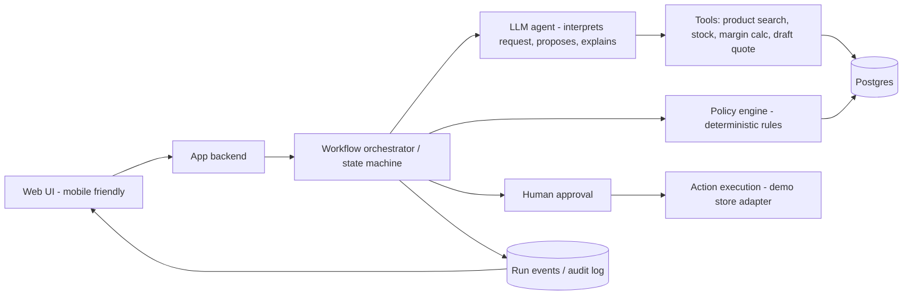

# Commercial Operations AI

AI-powered platform for intelligent business workflows, sales optimization, and commercial operations automation.

> **Status: planning.** Nothing below is implemented yet. Each feature is marked
> `planned`, `in progress`, or `done` in the status table, and a feature is only
> marked `done` after it has been implemented **and** tested.

## What it is

A web application (mobile-friendly) that turns a customer request or an existing
order into a **validated, human-approved commercial action**:

1. Understand the request and find relevant products.
2. Propose complementary bundles / a quote.
3. Check stock, compatibility, discount limits and minimum profit margin with
   **deterministic rules** (never with the LLM).
4. Explain each recommendation.
5. Let a human approve, reject or modify it.
6. Execute the approved action and persist the result with a full audit trail.

The UI shows the **real** workflow as it runs (live steps, tool calls, rule
checks, approvals). Progress is never faked: a step appears as finished only
after the backend has recorded it.

### What it is not

Not a generic CRM, not a chatbot with decorative cards, not a collection of
unrelated AI features. It is a decision-and-action layer with controlled execution.

## Research question (AI course)

> Does a deterministic constraint layer on top of an LLM agent remove invalid
> commercial actions without reducing recommendation quality?

Compared systems: (A) non-LLM baseline, (B) LLM agent without the policy layer,
(C) LLM agent with the policy layer.

## MVP scope

| # | Capability | Status |
|---|---|---|
| 1 | Import demo data (products, inventory, orders, prices) from CSV/JSON; mark records as synthetic or real | planned |
| 2 | Submit a customer request or select an existing order | planned |
| 3 | Bundle / quote recommendation with explanations | planned |
| 4 | Policy engine: stock, compatibility, discount limit, minimum margin | planned |
| 5 | Agent workflow with real tool calls (search, stock, margin calculation, draft quote) | planned |
| 6 | Live run timeline (steps, tool inputs/outputs, rule results) | planned |
| 7 | Human approval: approve / reject / modify / retry / cancel | planned |
| 8 | Execution in the demo environment + persisted result | planned |
| 9 | Audit log of decisions and status transitions | planned |
| 10 | Offline evaluation with repeatable scenarios | planned |

**Out of scope for the MVP** (possible later): proactive monitoring, long-term
memory, supplier comparison, customer-facing assistant, image generation,
real third-party store integration, custom model training.

## Acceptance criteria (MVP)

- [ ] Demo dataset loads and every record is labeled synthetic or real.
- [ ] A request creates a persisted workflow run with a unique ID.
- [ ] The timeline reflects real backend events and shows the same history after a page refresh.
- [ ] All prices, stock levels and margins come from the database or deterministic code, never from the model.
- [ ] A proposal that violates a rule can never reach the "approvable" state (unit tests with boundary cases; 0 violations across evaluation scenarios).
- [ ] Modifying a proposal triggers re-validation.
- [ ] Approving twice does not execute twice (idempotent execution).
- [ ] Model timeout or invalid output fails visibly with a clear message and no partial execution.
- [ ] Every run, rule result, approval and execution is visible in the audit log.
- [ ] The main workflow is usable on a 375 px wide screen.
- [ ] At least 30 scripted scenarios are evaluated against the baseline and the results are reported honestly.
- [ ] A public demo is deployed and demo data is clearly labeled.

## Architecture (planned)



Principles:

- The LLM interprets, proposes and explains. **Rules and tools decide numbers.**
- Structured outputs are validated before anything is executed.
- LLM provider sits behind an interface so it can be swapped (hosted free tier, local model).
- The store integration is an adapter; the first adapter targets the demo environment.

## Proposed stack (to be confirmed after a short technical spike)

| Layer | Choice |
|---|---|
| Frontend | Next.js (TypeScript) + shadcn/ui, installable PWA |
| Backend | Next.js route handlers / server actions |
| Database | Supabase Postgres (or local Postgres via Docker as fallback) |
| Live updates | Persisted run events + Server-Sent Events or Supabase Realtime (polling fallback) |
| LLM | Provider interface; free-tier hosted model and/or local model |
| Recommender | Co-occurrence / association rules computed offline (Colab, Python), stored in DB |
| Tests | Unit tests for rules, Playwright for the end-to-end workflow |
| Hosting | Vercel Hobby (non-commercial, fine for the academic demo) |

Free-tier limits change often. Re-verify pricing, quotas and regional availability
before depending on any service.

## Data

- Public retail datasets with permitted usage (e.g. Online Retail II, Olist) as the real core.
- Synthetic data only for what public datasets lack (cost, stock, expiry, edge cases).
- Every record carries `source` and `is_synthetic`.
- Evaluation results on synthetic data are **not** evidence of real business impact.

## Repository layout (planned)

```
/docs          requirements, use cases, UML, ADRs, evaluation protocol
/app           web application
/db            schema, migrations, seed scripts
/eval          scenarios and evaluation scripts
/notebooks     data analysis and offline recommender experiments
```

## Setup

To be written once the first runnable version exists. Environment variables will
be documented in `.env.example`. Secrets are never committed.

## Roadmap

1. Project foundation, schema, seed data
2. Policy engine with unit tests
3. Recommender and baseline
4. Agent workflow + live timeline
5. Approval and execution
6. Evaluation and report
7. Later: proactive monitoring, memory, what-if simulation

## License

To be decided before the first public release (check licenses of any template or dependency first).
