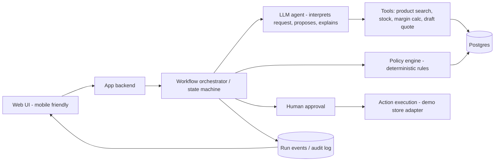

# Commercial Operations AI

AI-powered platform for intelligent business workflows, sales optimization, and commercial operations automation.

> **Status: early development (updated 2026-10-22).** Implemented and unit-tested (64 tests):
> the policy engine, the workflow runner with recorded events, a mock proposer,
> customer-owned-product handling, saved runs, approve/reject with transactional
> execution, the audit log and a public products API that never exposes cost.
> A live Gemini run (single-call mode) has been recorded end to end by hand; the
> tool-using agent has not been verified against live Gemini yet.
> The website is the Figma Make design, mounted at `/`; its screens still use
> hard-coded demo data and are **not connected to the backend yet**.
> A feature is only marked `done` after it is implemented **and** tested.

## What it is

A web application (mobile-friendly) that turns a customer request or an existing
order into a **validated, human-approved commercial action**:

1. Understand the request and find relevant products.
2. Propose complementary bundles / a quote.
3. Check stock, compatibility, discount limits and minimum profit margin with
   **deterministic rules** (never with the LLM).
4. Explain each recommendation.
5. Let a human approve, reject or modify it.
6. Execute the approved action and persist the result with a full audit trail.

The UI shows the **real** workflow as it runs (live steps, tool calls, rule
checks, approvals). Progress is never faked: a step appears as finished only
after the backend has recorded it.

### What it is not

Not a generic CRM, not a chatbot with decorative cards, not a collection of
unrelated AI features. It is a decision-and-action layer with controlled execution.

## Research question (AI course)

> Does a deterministic constraint layer on top of an LLM agent remove invalid
> commercial actions without reducing recommendation quality?

Compared systems: (A) non-LLM baseline, (B) LLM agent without the policy layer,
(C) LLM agent with the policy layer.

## MVP scope

| # | Capability | Status |
|---|---|---|
| 1 | Import demo data (products, inventory, orders, prices) from CSV/JSON; mark records as synthetic or real | partial (synthetic catalog and rules in a Postgres-compatible database; CSV/JSON import planned) |
| 2 | Submit a customer request or select an existing order | partial (request text only; order selection planned) |
| 3 | Bundle / quote recommendation with explanations | partial (LLM or mock proposer; no recommender or baseline yet) |
| 4 | Policy engine: stock, compatibility, discount limit, minimum margin | done (unit tested) |
| 5 | Agent workflow with real tool calls (search, stock, margin calculation, draft quote) | in progress (tool-using agent tested with a scripted model and a mock; not yet verified against live Gemini) |
| 6 | Live run timeline (steps, tool inputs/outputs, rule results) | in progress (live step events; tool calls not yet) |
| 7 | Human approval: approve / reject / modify / retry / cancel | partial (approve and reject work and are tested; modify, retry, cancel planned; no login yet) |
| 8 | Execution in the demo environment + persisted result | done (tested): one transaction removes stock and creates the order |
| 9 | Audit log of decisions and status transitions | done (tested) |
| 10 | Offline evaluation with repeatable scenarios | planned |
| 11 | Storefront and operator/owner screens (Figma Make design) | partial (design mounted at `/` with demo data; `GET /api/products` done and tested; screens not wired to the backend) |
| 12 | Customer shopping assistant: goal-first, structured results (cards, comparison, bundles), no cost or margin shown | planned |

**Out of scope for the MVP** (possible later): supplier sourcing and negotiation,
proactive monitoring, long-term memory, image generation, real third-party store
integration, custom model training.

## Acceptance criteria (MVP)

- [ ] Demo dataset loads and every record is labeled synthetic or real.
- [ ] A request creates a persisted workflow run with a unique ID.
- [ ] The timeline reflects real backend events and shows the same history after a page refresh.
- [ ] All prices, stock levels and margins come from the database or deterministic code, never from the model.
- [ ] A proposal that violates a rule can never reach the "approvable" state (unit tests with boundary cases; 0 violations across evaluation scenarios).
- [ ] Modifying a proposal triggers re-validation.
- [ ] Approving twice does not execute twice (idempotent execution).
- [ ] Model timeout or invalid output fails visibly with a clear message and no partial execution.
- [ ] Every run, rule result, approval and execution is visible in the audit log.
- [ ] The main workflow is usable on a 375 px wide screen.
- [ ] At least 30 scripted scenarios are evaluated against the baseline and the results are reported honestly.
- [ ] A public demo is deployed and demo data is clearly labeled.

## Architecture (planned)



Principles:

- The LLM interprets, proposes and explains. **Rules and tools decide numbers.**
- Structured outputs are validated before anything is executed.
- LLM provider sits behind an interface so it can be swapped (hosted free tier, local model).
- The store integration is an adapter; the first adapter targets the demo environment.

## Proposed stack (to be confirmed after a short technical spike)

| Layer | Choice |
|---|---|
| Frontend | Figma Make design exported to React and mounted in Next.js (TypeScript); the old shadcn template is retired (see `docs/decisions/0005-figma-owns-the-ui.md`) |
| Backend | Next.js route handlers / server actions |
| Database | Drizzle ORM + migrations. Local embedded Postgres (PGlite) by default; Supabase Postgres to be connected near the end (`docs/supabase.md`) |
| Live updates | Persisted run events + Server-Sent Events or Supabase Realtime (polling fallback) |
| LLM | Provider interface; free-tier hosted model and/or local model |
| Recommender | Co-occurrence / association rules computed offline (Colab, Python), stored in DB |
| Tests | Unit tests for rules, Playwright for the end-to-end workflow |
| Hosting | Vercel Hobby (non-commercial, fine for the academic demo) |

Free-tier limits change often. Re-verify pricing, quotas and regional availability
before depending on any service.

## Data

- Public retail datasets with permitted usage (e.g. Online Retail II, Olist) as the real core.
- Synthetic data only for what public datasets lack (cost, stock, expiry, edge cases).
- Every record carries `source` and `is_synthetic`.
- Evaluation results on synthetic data are **not** evidence of real business impact.

## Repository layout

```
/app                 Next.js application
  src/core           business rules, policy engine, agent, workflow runner
  src/db             schema, repositories, transactional execution
  src/data           synthetic demo catalog
  src/design/figma   Figma Make export (the website look)
  src/app            routes: (figma) site at /, (legacy) old template pages, api/
  drizzle            SQL migrations
/docs                decisions (ADRs), Figma integration, Supabase guide, inspiration, design exports
/eval                evaluation scenarios (planned)
/notebooks           offline recommender experiments (planned)
```

## Setup

```bash
cd app
npm install
cp ../.env.example .env.local     # then fill in GEMINI_API_KEY (or set LLM_MODE=mock)
npm test                          # unit tests
npm run db:check                  # shows which database is used and what is in it
npm run dev                       # the Figma site is at http://localhost:3000
```

Environment variables are documented in `.env.example`. Secrets are never committed.
Using Supabase instead of the local database: see `docs/supabase.md`.

## Roadmap

1. Done: foundation, schema, seed data, policy engine, saved runs, approval and execution
2. Now: Figma-based website. Redesign for the real catalog (phones, laptops, accessories), then wire each screen to the real API through adapters
3. Customer shopping assistant (goal-first, structured results) on top of the same agent and policy engine
4. Verify the tool-using agent on live Gemini; add modify/retry/cancel with re-validation
5. Login for the merchant workspace, then connect Supabase (dedicated project) and test on it
6. Offline evaluation (30+ scenarios) and the report
7. Later: proactive monitoring, memory, what-if simulation

Design inspiration (Alibaba AI Mode and Accio first, then IntelliCart and Amazon): `docs/inspiration.md`.

## License

To be decided before the first public release (check licenses of any template or dependency first).
